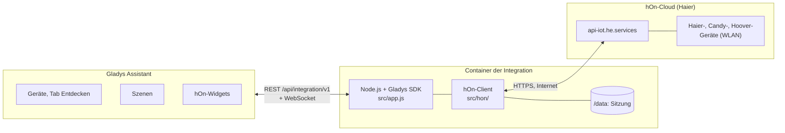
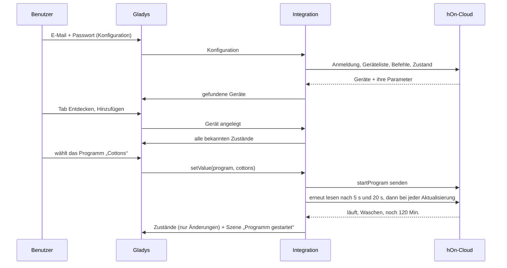
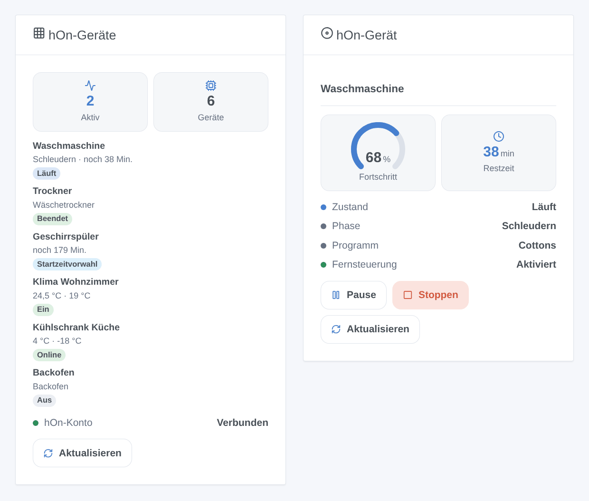

# hOn für Gladys Assistant

[English](README.md) | [Français](README.fr.md) | **Deutsch** | [Español](README.es.md)

[](LICENSE)
[](https://github.com/William-De71/gladys-hon/releases)
[](https://github.com/William-De71/gladys-hon/actions/workflows/release.yml)
[](https://gladysassistant.com)


Ihre Haier-, Candy- und Hoover-Geräte der hOn-App in Gladys Assistant: Waschmaschinen, Trockner, Geschirrspüler, Klimaanlagen, Kühlschränke und Backöfen auf dem Dashboard und in den Szenen. Verfolgen Sie ein Programm bis zum Ende, starten Sie ein Programm, lassen Sie sich benachrichtigen, wenn das Salz ausgeht.

## Funktionen

- **Konto**: E-Mail-Adresse und Passwort der hOn-App, über deren CIAM-Anmeldung (Juni 2026). Die Sitzung wird in `/data` gespeichert und nach einem Neustart wiederverwendet; eine abgelehnte Anmeldung pausiert die nächsten Versuche, statt das Konto zu sperren.
- **Geräte**, im Tab Entdecken mit den Funktionen, die jedes Modell meldet: Waschmaschinen, Waschtrockner, Wäschetrockner, Geschirrspüler, Klimaanlagen, Kühlschränke, Gefrierschränke, Weinkühlschränke, Backöfen und die übrigen hOn-Typen.
- **Befehle**: Programm starten (Programmauswahl), Programm pausieren und fortsetzen, Ein/Aus, Modus, Sollwert, Lüfterstufe und Schwenkung einer Klimaanlage, Sollwerte und Modi eines Kühlschranks, wenn die Fernsteuerung am Gerät aktiviert ist.
- **Zustände** alle 30 s bis 5 min gelesen, innerhalb der Gladys-Ratenbegrenzung veröffentlicht, mit einem Abzeichen Cloud / nicht erreichbar pro Gerät.
- **Zwei Widgets**: „hOn-Geräte“ (alle Geräte) und „hOn-Gerät“ (ein Gerät, sein Fortschritt und seine Tasten).
- **Sieben Szenenauslöser** (Programm gestartet, Programm beendet, Fehler, Nachfüllen, offline, online, Konto abgelehnt) und **drei Szenenaktionen** (Programm starten, Pause / Fortsetzen / Stopp, Zustand lesen).
- Englisch, Französisch, Deutsch und Spanisch.

## Funktionsweise




Die Integration listet die Geräte des Kontos alle 30 Minuten, liest ihre Befehle (Programme, Einstellungen) einmal täglich und ihren Zustand bei jeder Aktualisierung. Eine Funktion existiert, wenn das Gerät ihren Parameter meldet: Zwei Modelle desselben Typs können sich also unterscheiden.




### Geräte und Funktionen

| Gerät                                                  | Funktionen (Kategorie / Typ)                                                                                                                                                                                                                                                                          |
| ------------------------------------------------------ | ----------------------------------------------------------------------------------------------------------------------------------------------------------------------------------------------------------------------------------------------------------------------------------------------------- |
| Waschmaschine, Waschtrockner, Trockner, Geschirrspüler | Zustand, Phase (`text`), Programm (`text` / `select`, startet es), Restzeit (`duration`, min), Pause (`switch`), Tür (`opening-sensor`), Fernsteuerung, Salz und Klarspüler nachfüllen (`unknown` / `binary`), Energie (`energy-sensor` / `index`, kWh), Wasser (`volume-sensor`, L), Fehler (`text`) |
| Klimaanlage                                            | Ein/Aus, Modus, Sollwert, Lüfterstufe, vertikale und horizontale Schwenkung (`air-conditioning`), Innen- und Außentemperatur (`temperature-sensor`), Energie, Fehler                                                                                                                                  |
| Kühlschrank, Gefrierschrank, Weinkühlschrank           | Zonentemperaturen (`temperature-sensor`), Zonensollwerte (`thermostat` / `target-temperature`), Türen (`opening-sensor`), Superkühlen, Supergefrieren, Urlaubs- und Automatikmodus (`switch`), Raumtemperatur und -luftfeuchte, Fehler                                                                |
| Backofen                                               | Zustand, Restzeit, Fernsteuerung, Temperatur und gewählte Temperatur, Fehler (nur lesbar)                                                                                                                                                                                                             |
| Andere Typen (Haube, Kochfeld, Boiler, Luftreiniger…)  | Zustand, Temperatur, Restzeit, Fehler, sofern gemeldet                                                                                                                                                                                                                                                |

Externe ID eines Geräts: `ext:<selector>:appliance:<MAC-Adresse ohne Bindestriche>`; Funktionen: `…:<Funktionsschlüssel>`.

## Transport

`transports: ["cloud"]`: Alles läuft über die hOn-Cloud, über das Internet — Ihre Geräte, ihre Zustände und Ihre Befehle laufen über die Server von Haier. Jedes Gerät trägt ein Abzeichen **Cloud**, oder **nicht erreichbar**, wenn es nicht mit der hOn-Cloud verbunden ist (Stromausfall, WLAN) oder das Konto abgelehnt wird. Es gibt keinen lokalen Kanal, also keine Schaltfläche „Lokale Verbindung bevorzugen“.

## Widgets



- **hOn-Geräte**: Anzahl aktiver und aller Geräte, jedes Gerät mit Zustandsabzeichen, Phase und Restzeit (oder Temperaturen), Status des hOn-Kontos, eine Taste Aktualisieren. Einstellung: alle Geräte oder nur die laufenden.
- **hOn-Gerät**: ein in den Einstellungen gewähltes Gerät: Zustand, Phase, Programm, Fernsteuerung, Fehler, eine Fortschrittsanzeige und die Restzeit während eines Programms, Temperaturen und die Tasten Pause, Fortsetzen, Stoppen (mit Bestätigung) oder Einschalten / Ausschalten.

Die Bilder werden von `docs/illustrations/render.sh` aus dem echten Widget-Code erzeugt: Es sind Illustrationen, keine Screenshots.

## Szenenauslöser und -aktionen

| Auslöser            | Filter              | Variablen                                                       |
| ------------------- | ------------------- | --------------------------------------------------------------- |
| `cycle_started`     | Gerät, Typ          | `device_name`, `appliance_type`, `program`, `remaining_minutes` |
| `cycle_finished`    | Gerät, Typ          | `device_name`, `appliance_type`, `program`, `duration_minutes`  |
| `appliance_error`   | Gerät               | `device_name`, `appliance_type`, `error_code`                   |
| `refill_needed`     | Gerät, Nachzufüllen | `device_name`, `appliance_type`, `item`                         |
| `appliance_offline` | Gerät               | `device_name`, `appliance_type`                                 |
| `appliance_online`  | Gerät               | `device_name`, `appliance_type`                                 |
| `account_error`     |                     | `reason`                                                        |

| Aktion           | Felder                                   | Ausgaben                                                                                    |
| ---------------- | ---------------------------------------- | ------------------------------------------------------------------------------------------- |
| `start_program`  | Gerät, Programm, Startzeitvorwahl (Min.) | `program`, `estimated_minutes`                                                              |
| `control_cycle`  | Gerät, `pause` / `resume` / `stop`       |                                                                                             |
| `refresh_status` | Gerät                                    | `machine_state`, `program_phase`, `program`, `remaining_minutes`, `connected`, `error_code` |

Ein von einer Szenenaktion gesendeter Befehl löst nie einen Auslöser aus (der verursachte Übergang wird für dieses Gerät ignoriert). Beispiele:

- **Das Programm der Waschmaschine ist beendet** → „Die Wäsche ist fertig ({{triggerEvent.data.duration_minutes}} Min.)“ senden.
- **Der Geschirrspüler braucht Salz** → die Familie benachrichtigen.
- Werktags um 13 Uhr, im Niedertarif → **hOn-Programm starten** `eco_40_60` auf der morgens beladenen Waschmaschine.

## Voraussetzungen

- Gladys Assistant **5.1.1 oder neuer** (Dashboard-Widgets sowie Szenenauslöser und -aktionen von Integrationen; ältere Instanzen können die Integration nicht installieren).
- Ein hOn-Konto, in dem die Geräte hinzugefügt und verbunden sind. Melden Sie sich nach dem Anlegen des Kontos oder einer Passwortänderung einmal in der hOn-App an. Konten mit Zwei-Schritt-Bestätigung per E-Mail werden nicht unterstützt.
- Internetzugang für Gladys.

## Installation

- **Aus dem Store**: Integrationen → „hOn“ suchen → Installieren.
- **Über die Repository-URL**: Integrationen → Integration installieren → `https://github.com/William-De71/gladys-hon` einfügen.
- **Entwicklermodus**: Integrationen → Integration installieren → Entwicklermodus, mit dem Manifest eines Builds (die Zusammenfassung des Workflows „Build and publish image“ zeigt es an).

## Konfiguration

| Feld            | Typ    | Standard | Bedeutung                                                      |
| --------------- | ------ | -------- | -------------------------------------------------------------- |
| `email`         | string |          | E-Mail-Adresse des hOn-Kontos                                  |
| `password`      | secret |          | Passwort des hOn-Kontos                                        |
| `poll_interval` | select | `60`     | Aktualisierungsintervall in Sekunden: `30`, `60`, `120`, `300` |
| `language`      | select | `en`     | Sprache der Funktionsnamen und der Textzustände                |

Schaltflächen der Konfigurationsseite: **Verbindung testen** (meldet sich an und listet die Geräte mit ihrem Zustand), **Programme auflisten** (die Programmnamen der Szenenaktion `start_program`).

## Verwendung

1. E-Mail-Adresse und Passwort des hOn-Kontos eingeben, speichern, **Verbindung testen** drücken.
2. Die Geräte im Tab **Entdecken** hinzufügen.
3. Um ein Programm aus Gladys zu starten, zuerst die Fernsteuerung am Gerät aktivieren.
4. Die Widgets zu einem Dashboard hinzufügen, Szenen erstellen.

Die Benutzerdokumentation liegt in [docs/de.md](docs/de.md) ([en](docs/en.md), [fr](docs/fr.md), [es](docs/es.md)).

## Grenzen

- Die hOn-API ist nicht öffentlich: Diese Integration nutzt die Schnittstelle der hOn-App, portiert aus [pyhOn](https://github.com/Andre0512/pyhOn) / [pyhon-revived](https://github.com/mmalolepszy/pyhon-revived). Haier kann sie jederzeit ändern (so geschehen im Juni 2026).
- Zustände werden abgefragt (mindestens alle 30 s); der Push-Kanal der App (MQTT) wird noch nicht genutzt.
- Programmnamen sind die der hOn-Cloud, auf Englisch. Geführte Rezepte und Backofenprogramme lassen sich nicht starten.
- Ein Gladys-Gerät pro hOn-Gerät: Mehrzonengeräte, die hOn pro Zone listet, zeigen nur die erste.
- Superkühlen, Supergefrieren, Urlaubs- und Automatikmodus sind bei Kühlschränken, deren Einstellungen sie nicht enthalten, nur lesbar.
- Getestet mit den anonymisierten Gerätedaten von [hon-test-data](https://github.com/Andre0512/hon-test-data), noch nicht mit einem echten Konto: Rückmeldungen willkommen.

## Lokale Entwicklung

```bash
npm install
GLADYS_HOST_API_URL=http://localhost:1443 \
  GLADYS_INTEGRATION_TOKEN=… GLADYS_INTEGRATION_SELECTOR=… \
  HON_DATA_DIR=./data DEBUG=gladys-integration-sdk node index.js
```

| Variable                                                                         | Standard           | Verwendung                                      |
| -------------------------------------------------------------------------------- | ------------------ | ----------------------------------------------- |
| `GLADYS_HOST_API_URL`, `GLADYS_INTEGRATION_TOKEN`, `GLADYS_INTEGRATION_SELECTOR` | von Gladys gesetzt | Verbindung zur Host-API von Gladys              |
| `HON_DATA_DIR`                                                                   | `/data`            | Ordner von `session.json` und `device.json`     |
| `DEBUG`                                                                          | leer               | `gladys-integration-sdk` für die SDK-Protokolle |

| Skript                            | Funktion                                 |
| --------------------------------- | ---------------------------------------- |
| `npm test`                        | die Tests (`node --test`), ohne Netzwerk |
| `npm run lint`                    | ESLint                                   |
| `npm run format` / `format:check` | Prettier                                 |
| `docs/illustrations/render.sh`    | die Widget-Illustrationen neu erzeugen   |
| `scripts/build-cover.sh`          | `cover.jpg` aus `cover.svg` neu erzeugen |

## Tests

`npm test` führt die ganze Integration gegen das Fake-Gladys des SDK und eine Fake-hOn-Cloud aus, die die anonymisierten Daten von sechs echten Geräten liefert (Waschmaschine, Trockner, Geschirrspüler, Klimaanlage, Kühlschrank, Backofen): Anmeldung, Sitzungserneuerung und Pause nach Ablehnung, Erkennung, Zustände, Befehle und ihre genauen Nutzdaten, Szenenauslöser und -aktionen, mit `validateWidgetContent` geprüfte Widgets. Jede Funktion wird gegen die Regeln des Gladys-Kerns und eine Erkennungs-Referenz geprüft (externe IDs sind für immer), das Manifest gegen den Code, die Übersetzungen und das Release-Skript. Die CI baut außerdem das Image und startet es wie Gladys (schreibgeschützt, 256 MB, ohne Netzwerk).

## Release-Prozess

Jeder Merge auf `main` veröffentlicht eine Version, wenn seine Commits es rechtfertigen, ohne manuellen Schritt:

```mermaid
flowchart LR
  A[Merge auf main] --> B[CI: Prettier, ESLint,<br/>Tests, Docker-Build]
  B --> C[nächste Version aus den<br/>Conventional Commits]
  C --> D[Abschnitt in CHANGELOG.md]
  D --> E[Commit chore release<br/>+ Tag vX.Y.Z]
  E --> F[Image :X.Y.Z + :latest<br/>amd64 + arm64]
  F --> G[main rückt auf den<br/>Release-Commit vor]
  G --> H[GitHub Release]
  H --> I[Prüfung: anonymer Pull,<br/>Store-Validator, Topic]
```




- `feat` → Minor, `fix` / `perf` → Patch, `!` oder `BREAKING CHANGE:` → Major (ein Minor unter 1.0.0). `docs`, `chore`, `ci`, `test`, `style`, `refactor`, `build` allein veröffentlichen nichts.
- Der Titel des Pull Requests wird zum Squash-Commit, also zur Changelog-Zeile: auf Englisch, für den Benutzer schreiben (`feat(devices): …`). `pr-title.yml` prüft ihn. `CHANGELOG.md` nie von Hand bearbeiten.
- Das Image existiert, bevor `main` seine Version ankündigt (der Store indexiert `main`).
- 1.0.0 ist eine manuelle Entscheidung: Actions → Release → Run workflow, `release-as: 1.0.0`. `dry-run` zeigt Version und Changelog, ohne zu veröffentlichen.
- **Geschütztes `main`**: Das Release pusht einen Commit auf `main`. Mit Branch-Schutz oder Ruleset GitHub Actions die Umgehung erlauben (oder eine GitHub App nutzen), sonst endet das Release nach dem Image.
- Nach dem ersten Release das Paket öffentlich machen: Package settings → Change visibility → Public.

## Fehlerbehebung

- **„hOn hat die E-Mail-Adresse oder das Passwort abgelehnt“**: In der hOn-App prüfen. Dieselbe Antwort kommt, wenn sich das Konto zu oft angemeldet hat: Die Integration wartet (15 Min., dann länger) und versucht es selbst erneut.
- **„Die Fernsteuerung ist deaktiviert“**: Am Bedienfeld des Geräts aktivieren; die meisten Modelle schalten sie am Programmende ab.
- **Kein Gerät**: In der hOn-App hinzufügen, dann **Verbindung testen**.
- **Eine Funktion fehlt**: Die Funktionen folgen dem, was das Modell meldet; ein Issue mit Typ und Modell eröffnen (Geräteparameter `HON_TYPE` und `HON_MODEL`).
- Protokolle: der Tab Protokolle der Integration; `DEBUG=gladys-integration-sdk` für SDK-Details.

## Mitwirken

Issues und Pull Requests sind willkommen. `npm run format:check`, `npm run lint` und `npm test` ausführen, den Titel des Pull Requests als Conventional Commit schreiben und nach jeder Änderung eines Widget-Inhalts `docs/illustrations/render.sh` ausführen. Eine neue Funktion braucht ein von Gladys beschriftetes Kategorie/Typ-Paar (`test/devices.test.js`) und darf keine bestehende ändern (`test/fixtures/discovery.baseline.json`).

## Sicherheit

Siehe [SECURITY.md](SECURITY.md). Das Passwort ist ein `secret`-Feld: nie protokolliert, nie an den Browser zurückgeschickt, nur an die hOn-Cloud gesendet. Die Sitzung in `/data` ist nur für den Container-Benutzer lesbar.

## Lizenz

[Apache License 2.0](LICENSE), siehe auch [NOTICE](NOTICE). Der hOn-Client ist eine Portierung von [pyhOn](https://github.com/Andre0512/pyhOn) und [pyhon-revived](https://github.com/mmalolepszy/pyhon-revived) (MIT, [licenses/pyhOn-MIT.txt](licenses/pyhOn-MIT.txt)); die Testdaten stammen aus [hon-test-data](https://github.com/Andre0512/hon-test-data) (MIT). hOn, Haier, Candy und Hoover sind Marken ihrer Inhaber; dieses Projekt ist nicht mit Haier Europe verbunden und wird von Haier Europe weder unterstützt noch empfohlen.
