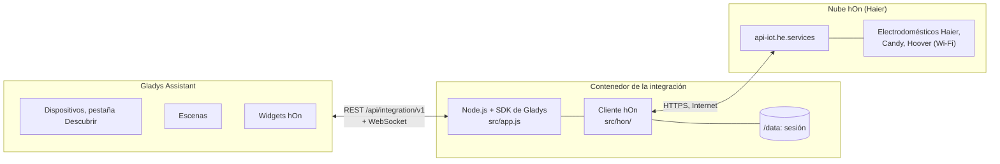
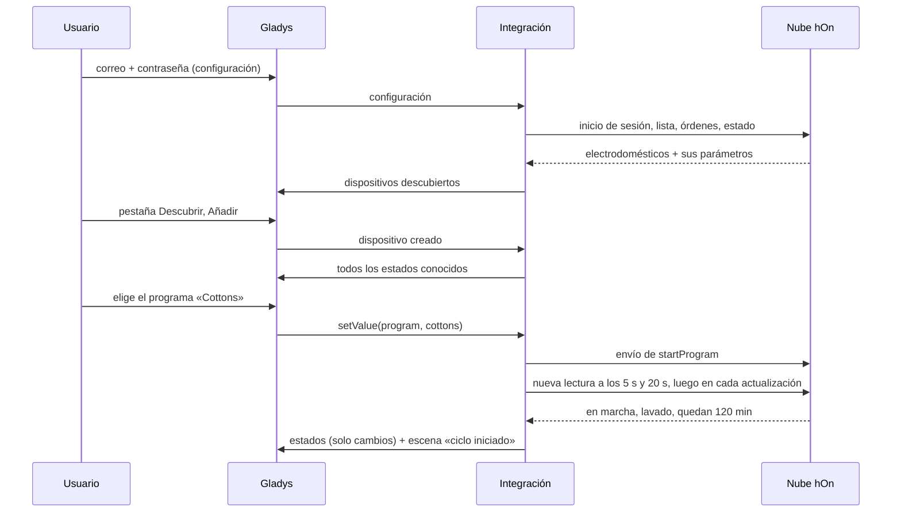
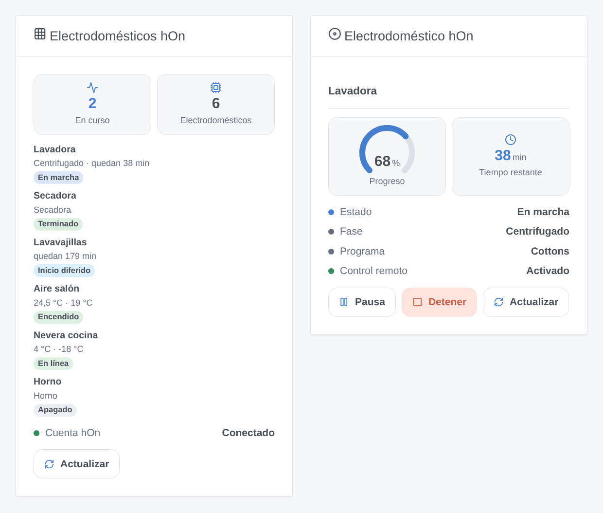

# hOn para Gladys Assistant

[English](README.md) | [Français](README.fr.md) | [Deutsch](README.de.md) | **Español**

[](LICENSE)
[](https://github.com/William-De71/gladys-hon/releases)
[](https://github.com/William-De71/gladys-hon/actions/workflows/release.yml)
[](https://gladysassistant.com)


Sus electrodomésticos Haier, Candy y Hoover de la app hOn en Gladys Assistant: lavadoras, secadoras, lavavajillas, aires acondicionados, frigoríficos y hornos en el panel y en las escenas. Siga un ciclo hasta el final, inicie un programa, reciba un aviso cuando se acabe la sal.

## Funciones

- **Cuenta**: el correo electrónico y la contraseña de la app hOn, mediante su inicio de sesión CIAM (junio de 2026). La sesión se guarda en `/data` y se reutiliza tras un reinicio; un inicio de sesión rechazado pausa los siguientes intentos en lugar de bloquear la cuenta.
- **Dispositivos**, en la pestaña Descubrir con las funciones que comunica cada modelo: lavadoras, lavadoras secadoras, secadoras, lavavajillas, aires acondicionados, frigoríficos, congeladores, vinotecas, hornos y los demás tipos hOn.
- **Órdenes**: iniciar un programa (selección de programa), pausar y reanudar un ciclo, encendido/apagado, modo, consigna, ventilador y oscilación de un aire acondicionado, consignas y modos de un frigorífico, con el control remoto activado en el electrodoméstico.
- **Estados** leídos cada 30 s a 5 min, publicados dentro del límite de Gladys, con una insignia nube / inaccesible por electrodoméstico.
- **Dos widgets**: «Electrodomésticos hOn» (todos) y «Electrodoméstico hOn» (uno, su progreso y sus botones).
- **Siete disparadores de escena** (ciclo iniciado, ciclo terminado, error, recarga, desconexión, reconexión, cuenta rechazada) y **tres acciones de escena** (iniciar un programa, pausar / reanudar / detener, leer el estado).
- Inglés, francés, alemán y español.

## Funcionamiento




La integración lista los electrodomésticos de la cuenta cada 30 minutos, lee sus órdenes (programas, ajustes) una vez al día y su estado en cada actualización. Una función existe cuando el electrodoméstico comunica su parámetro: dos modelos del mismo tipo pueden diferir.




### Dispositivos y funciones

| Electrodoméstico                                       | Funciones (categoría / tipo)                                                                                                                                                                                                                                                                            |
| ------------------------------------------------------ | ------------------------------------------------------------------------------------------------------------------------------------------------------------------------------------------------------------------------------------------------------------------------------------------------------- |
| Lavadora, lavadora secadora, secadora, lavavajillas    | Estado, Fase (`text`), Programa (`text` / `select`, lo inicia), Tiempo restante (`duration`, min), Pausa (`switch`), Puerta (`opening-sensor`), Control remoto, Reponer sal y abrillantador (`unknown` / `binary`), Energía (`energy-sensor` / `index`, kWh), Agua (`volume-sensor`, L), Error (`text`) |
| Aire acondicionado                                     | Encendido/apagado, Modo, Consigna, Velocidad del ventilador, Oscilación vertical y horizontal (`air-conditioning`), temperaturas interior y exterior (`temperature-sensor`), Energía, Error                                                                                                             |
| Frigorífico, congelador, vinoteca                      | Temperaturas de zona (`temperature-sensor`), consignas de zona (`thermostat` / `target-temperature`), puertas (`opening-sensor`), superfrío, supercongelación, modos vacaciones y automático (`switch`), lista Modo (`text` / `select`), temperatura y humedad ambiente, Error                          |
| Horno                                                  | Estado, Tiempo restante, Control remoto, temperatura y temperatura elegida, Error (solo lectura)                                                                                                                                                                                                        |
| Otros tipos (campana, placa, calentador, purificador…) | Estado, temperatura, tiempo restante, Error, si se comunican                                                                                                                                                                                                                                            |

Identificador externo de un dispositivo: `ext:<selector>:appliance:<dirección MAC sin guiones>`; funciones: `…:<clave de la función>`.

## Transporte

`transports: ["cloud"]`: todo pasa por la nube hOn, a través de Internet — sus electrodomésticos, sus estados y sus órdenes pasan por los servidores de Haier. Cada electrodoméstico lleva una insignia **nube**, o **inaccesible** cuando no está conectado a la nube hOn (corte de luz, Wi-Fi) o se rechaza la cuenta. No hay canal local, así que no hay botón «Preferir la conexión local».

## Widgets



- **Electrodomésticos hOn**: número en curso, número de electrodomésticos, cada uno con su insignia de estado, su fase y su tiempo restante (o sus temperaturas), el estado de la cuenta hOn, un botón Actualizar. Ajuste: todos o solo los que están en marcha.
- **Electrodoméstico hOn**: uno elegido en los ajustes: estado, fase, programa, control remoto, error, un indicador de progreso y el tiempo restante durante un ciclo, temperaturas (las consignas de un frigorífico que no las informa) y los botones Pausa, Reanudar, Detener (con confirmación) o Encender / Apagar.

Las imágenes las genera `docs/illustrations/render.sh` a partir del código real de los widgets: son ilustraciones, no capturas de pantalla.

## Disparadores y acciones de escena

| Disparador          | Filtros                   | Variables                                                       |
| ------------------- | ------------------------- | --------------------------------------------------------------- |
| `cycle_started`     | electrodoméstico, tipo    | `device_name`, `appliance_type`, `program`, `remaining_minutes` |
| `cycle_finished`    | electrodoméstico, tipo    | `device_name`, `appliance_type`, `program`, `duration_minutes`  |
| `appliance_error`   | electrodoméstico          | `device_name`, `appliance_type`, `error_code`                   |
| `refill_needed`     | electrodoméstico, recarga | `device_name`, `appliance_type`, `item`                         |
| `appliance_offline` | electrodoméstico          | `device_name`, `appliance_type`                                 |
| `appliance_online`  | electrodoméstico          | `device_name`, `appliance_type`                                 |
| `account_error`     |                           | `reason`                                                        |

| Acción           | Campos                                            | Salidas                                                                                     |
| ---------------- | ------------------------------------------------- | ------------------------------------------------------------------------------------------- |
| `start_program`  | electrodoméstico, programa, inicio diferido (min) | `program`, `estimated_minutes`                                                              |
| `control_cycle`  | electrodoméstico, `pause` / `resume` / `stop`     |                                                                                             |
| `refresh_status` | electrodoméstico                                  | `machine_state`, `program_phase`, `program`, `remaining_minutes`, `connected`, `error_code` |

Una orden enviada por una acción de escena nunca activa un disparador (la transición que provoca se ignora para ese electrodoméstico). Ejemplos:

- **Termina el ciclo de la lavadora** → enviar «La ropa está lista ({{triggerEvent.data.duration_minutes}} min)».
- **El lavavajillas necesita sal** → avisar a la familia.
- Cada día laborable a las 13 h, en horas valle → **Iniciar un programa hOn** `eco_40_60` en la lavadora cargada por la mañana.

## Requisitos

- Gladys Assistant **5.3.0 o posterior** (palabras clave del catálogo de Gladys 5.3, widgets del panel y disparadores y acciones de escena de las integraciones; las instancias más antiguas no pueden instalar la integración).
- Una cuenta hOn con los electrodomésticos añadidos y conectados. Inicie sesión una vez en la app hOn tras crear la cuenta o cambiar la contraseña. Las cuentas con verificación en dos pasos por correo no son compatibles.
- Acceso a Internet para Gladys.

## Instalación

- **Desde la tienda**: Integraciones → buscar «hOn» → Instalar.
- **Desde la URL del repositorio**: Integraciones → Instalar una integración → pegar `https://github.com/William-De71/gladys-hon`.
- **Modo desarrollador**: Integraciones → Instalar una integración → Modo desarrollador, con el manifiesto de un build (el resumen del workflow «Build and publish image» lo muestra).

## Configuración

| Campo           | Tipo   | Por defecto | Significado                                                      |
| --------------- | ------ | ----------- | ---------------------------------------------------------------- |
| `email`         | string |             | correo electrónico de la cuenta hOn                              |
| `password`      | secret |             | contraseña de la cuenta hOn                                      |
| `poll_interval` | select | `60`        | intervalo de actualización en segundos: `30`, `60`, `120`, `300` |
| `language`      | select | `en`        | idioma de los nombres de las funciones y de los estados de texto |

Botones de la página de configuración: **Probar la conexión** (inicia sesión y lista los electrodomésticos con su estado), **Listar los programas** (los nombres de programa de la acción de escena `start_program`), **Diagnóstico** (escribe en la pestaña Registros lo que informa cada electrodoméstico, para un informe).

## Uso

1. Introduzca el correo y la contraseña de la cuenta hOn, guarde, pulse **Probar la conexión**.
2. Añada los electrodomésticos desde la pestaña **Descubrir**.
3. Para iniciar un programa desde Gladys, active antes el control remoto en el electrodoméstico.
4. Añada los widgets a un panel, cree sus escenas.

La documentación de usuario está en [docs/es.md](docs/es.md) ([en](docs/en.md), [fr](docs/fr.md), [de](docs/de.md)).

## Límites

- La API de hOn no es pública: esta integración usa la interfaz de la app hOn, portada desde [pyhOn](https://github.com/Andre0512/pyhOn) / [pyhon-revived](https://github.com/mmalolepszy/pyhon-revived). Haier puede cambiarla en cualquier momento (lo hizo en junio de 2026).
- Los estados se consultan (30 s como mínimo); el canal push de la app (MQTT) aún no se usa.
- Los nombres de programa son los de la nube hOn, en inglés. Las recetas guiadas y los programas de horno no se pueden iniciar.
- Un dispositivo de Gladys por electrodoméstico hOn: los electrodomésticos multizona que hOn lista por zona muestran solo la primera.
- Los modos del frigorífico se inician con los programas del electrodoméstico, como hace la app hOn; un congelador cuyos modos dependen de su consigna los mantiene de solo lectura. Un frigorífico añadido con una versión anterior obtiene la lista **Modo** y sus modos controlables con el botón **Actualizar** de la pestaña Descubrir.
- Probada con los datos anonimizados de electrodomésticos de [hon-test-data](https://github.com/Andre0512/hon-test-data), aún no con una cuenta real: sus comentarios son bienvenidos.

## Desarrollo local

```bash
npm install
GLADYS_HOST_API_URL=http://localhost:1443 \
  GLADYS_INTEGRATION_TOKEN=… GLADYS_INTEGRATION_SELECTOR=… \
  HON_DATA_DIR=./data DEBUG=gladys-integration-sdk node index.js
```

| Variable                                                                         | Por defecto          | Uso                                                 |
| -------------------------------------------------------------------------------- | -------------------- | --------------------------------------------------- |
| `GLADYS_HOST_API_URL`, `GLADYS_INTEGRATION_TOKEN`, `GLADYS_INTEGRATION_SELECTOR` | definidas por Gladys | conexión con la API anfitriona de Gladys            |
| `HON_DATA_DIR`                                                                   | `/data`              | carpeta de `session.json` y `device.json`           |
| `DEBUG`                                                                          | vacía                | `gladys-integration-sdk` para los registros del SDK |

| Script                            | Qué hace                                      |
| --------------------------------- | --------------------------------------------- |
| `npm test`                        | las pruebas (`node --test`), sin red          |
| `npm run lint`                    | ESLint                                        |
| `npm run format` / `format:check` | Prettier                                      |
| `docs/illustrations/render.sh`    | regenerar las ilustraciones de los widgets    |
| `scripts/build-cover.sh`          | regenerar `cover.jpg` a partir de `cover.svg` |

## Pruebas

`npm test` ejecuta toda la integración contra el Gladys falso del SDK y una nube hOn falsa que sirve los datos anonimizados de seis electrodomésticos reales (lavadora, secadora, lavavajillas, aire acondicionado, frigorífico, horno): inicio de sesión, renovación de la sesión y pausa tras un rechazo, descubrimiento, estados, órdenes y sus cargas exactas, disparadores y acciones de escena, widgets validados por `validateWidgetContent`. Cada función se comprueba contra las reglas del núcleo de Gladys y una referencia de descubrimiento (los identificadores externos son para siempre), el manifiesto contra el código, las traducciones y el script de release. La CI también construye la imagen y la arranca como Gladys (solo lectura, 256 MB, sin red).

## Proceso de release

Cada fusión en `main` publica una versión cuando sus commits lo justifican, sin ningún paso manual:

```mermaid
flowchart LR
  A[fusión en main] --> B[CI: Prettier, ESLint,<br/>pruebas, build Docker]
  B --> C[siguiente versión según<br/>los Conventional Commits]
  C --> D[sección de CHANGELOG.md]
  D --> E[commit chore release<br/>+ tag vX.Y.Z]
  E --> F[imagen :X.Y.Z + :latest<br/>amd64 + arm64]
  F --> G[main avanza hasta el<br/>commit de release]
  G --> H[GitHub Release]
  H --> I[verificación: pull anónimo,<br/>validador de la tienda, topic]
```




- `feat` → menor, `fix` / `perf` → parche, `!` o `BREAKING CHANGE:` → mayor (una menor por debajo de 1.0.0). `docs`, `chore`, `ci`, `test`, `style`, `refactor`, `build` solos no publican nada.
- El título de la pull request se convierte en el commit squash, y por tanto en la línea del changelog: escríbalo en inglés, para el usuario (`feat(devices): …`). `pr-title.yml` lo comprueba. Nunca edite `CHANGELOG.md` a mano.
- La imagen existe antes de que `main` anuncie su versión (la tienda indexa `main`).
- La 1.0.0 es una decisión manual: Actions → Release → Run workflow, `release-as: 1.0.0`. `dry-run` muestra la versión y el changelog sin publicar nada.
- **`main` protegida**: la release empuja un commit a `main`. Con una protección de rama o un ruleset, permita que GitHub Actions la omita (o use una GitHub App); si no, la release se detiene tras la imagen.
- Tras la primera release, haga público el paquete: Package settings → Change visibility → Public.

## Solución de problemas

- **«hOn rechazó el correo electrónico o la contraseña»**: compruébelos en la app hOn. La misma respuesta llega cuando la cuenta ha iniciado sesión demasiadas veces: la integración espera (15 min, luego más) y reintenta sola.
- **«El control remoto está desactivado»**: actívelo en el panel del electrodoméstico; la mayoría de los modelos lo desactivan al final del ciclo.
- **Ningún electrodoméstico**: añádalos en la app hOn y luego **Probar la conexión**.
- **Falta una función**: las funciones siguen lo que comunica el modelo; abra una issue con el tipo y el modelo (parámetros `HON_TYPE` y `HON_MODEL` del dispositivo).
- Registros: la pestaña Registros de la integración. Para un informe, pulse **Diagnóstico** en la configuración y copie las líneas que empiezan por `hOn diagnostic` (Gladys no permite pasar `DEBUG` al contenedor: esa variable solo sirve para una ejecución local).

## Contribuir

Las issues y pull requests son bienvenidas. Ejecute `npm run format:check`, `npm run lint` y `npm test`, escriba el título de la pull request como un Conventional Commit y ejecute `docs/illustrations/render.sh` tras cualquier cambio en el contenido de un widget. Una nueva función necesita un par categoría/tipo con etiqueta en Gladys (`test/devices.test.js`) y no debe cambiar una existente (`test/fixtures/discovery.baseline.json`).

## Seguridad

Véase [SECURITY.md](SECURITY.md). La contraseña es un campo `secret`: nunca se registra, nunca se devuelve al navegador, solo se envía a la nube hOn. La sesión en `/data` solo la puede leer el usuario del contenedor.

## Licencia

[Licencia Apache 2.0](LICENSE), véase también [NOTICE](NOTICE). El cliente hOn es una adaptación de [pyhOn](https://github.com/Andre0512/pyhOn) y [pyhon-revived](https://github.com/mmalolepszy/pyhon-revived) (MIT, [licenses/pyhOn-MIT.txt](licenses/pyhOn-MIT.txt)); los datos de prueba proceden de [hon-test-data](https://github.com/Andre0512/hon-test-data) (MIT). hOn, Haier, Candy y Hoover son marcas de sus propietarios; este proyecto no está afiliado a Haier Europe ni cuenta con su aprobación o respaldo.
