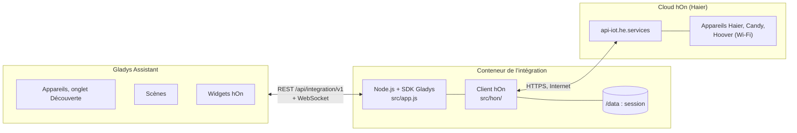
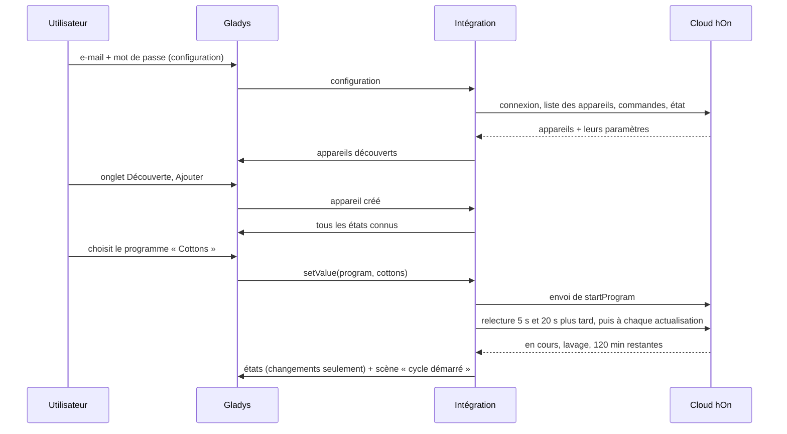
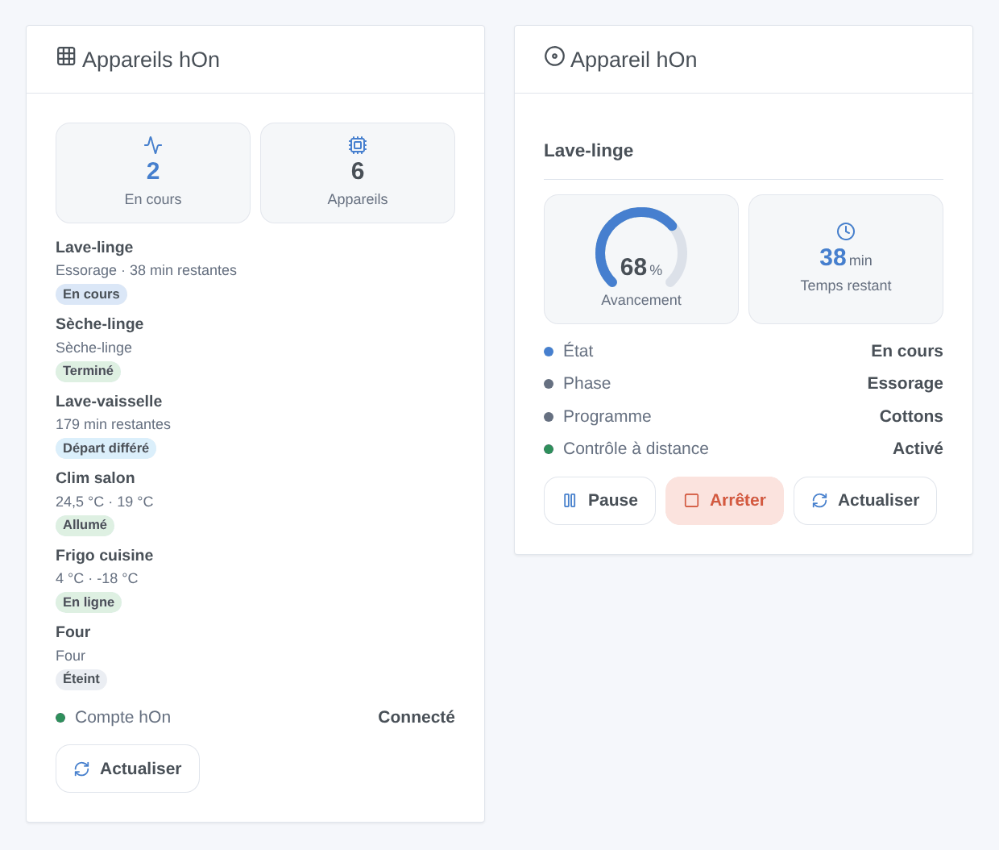

# hOn pour Gladys Assistant

[English](README.md) | **Français** | [Deutsch](README.de.md) | [Español](README.es.md)

[](LICENSE)
[](https://github.com/William-De71/gladys-hon/releases)
[](https://github.com/William-De71/gladys-hon/actions/workflows/release.yml)
[](https://gladysassistant.com)


Vos appareils Haier, Candy et Hoover de l’application hOn dans Gladys Assistant : lave-linge, sèche-linge, lave-vaisselle, climatiseurs, réfrigérateurs et fours sur le tableau de bord et dans les scènes. Suivez un cycle jusqu’au bout, lancez un programme, soyez prévenu quand il manque du sel.

## Fonctionnalités

- **Compte** : l’adresse e-mail et le mot de passe de l’application hOn, via sa connexion CIAM (juin 2026). La session est gardée dans `/data` et réutilisée après un redémarrage ; une connexion refusée met en pause les tentatives suivantes au lieu de bloquer le compte.
- **Appareils**, trouvés dans l’onglet Découverte avec les fonctionnalités que chaque modèle remonte : lave-linge, lave-linge séchants, sèche-linge, lave-vaisselle, climatiseurs, réfrigérateurs, congélateurs, caves à vin, fours et les autres types hOn.
- **Commandes** : lancer un programme (choix du programme), mettre en pause et reprendre un cycle, marche/arrêt, mode, consigne, ventilation et oscillation d’un climatiseur, consignes et modes d’un réfrigérateur, quand le contrôle à distance est activé sur l’appareil.
- **États** lus toutes les 30 s à 5 min, publiés dans la limite de débit de Gladys, avec un badge cloud / injoignable par appareil.
- **Deux widgets** : « Appareils hOn » (tous les appareils) et « Appareil hOn » (un appareil, son avancement et ses boutons).
- **Sept déclencheurs de scène** (cycle démarré, cycle terminé, erreur, remplissage, déconnexion, reconnexion, compte refusé) et **trois actions de scène** (lancer un programme, pause / reprise / arrêt, lire l’état).
- Anglais, français, allemand et espagnol.

## Fonctionnement




L’intégration liste les appareils du compte toutes les 30 minutes, lit leurs commandes (programmes, réglages) une fois par jour et leur état à chaque actualisation. Une fonctionnalité existe quand l’appareil remonte son paramètre : deux modèles d’un même type peuvent donc différer.




### Appareils et fonctionnalités

| Appareil                                                    | Fonctionnalités (catégorie / type)                                                                                                                                                                                                                                                                                |
| ----------------------------------------------------------- | ----------------------------------------------------------------------------------------------------------------------------------------------------------------------------------------------------------------------------------------------------------------------------------------------------------------- |
| Lave-linge, lave-linge séchant, sèche-linge, lave-vaisselle | État, Phase (`text`), Programme (`text` / `select`, le lance), Temps restant (`duration`, min), Pause (`switch`), Porte (`opening-sensor`), Contrôle à distance, Sel et liquide de rinçage à remettre (`unknown` / `binary`), Énergie (`energy-sensor` / `index`, kWh), Eau (`volume-sensor`, L), Erreur (`text`) |
| Climatiseur                                                 | Marche/arrêt, Mode, Consigne, Vitesse de ventilation, Oscillation verticale et horizontale (`air-conditioning`), températures intérieure et extérieure (`temperature-sensor`), Énergie, Erreur                                                                                                                    |
| Réfrigérateur, congélateur, cave à vin                      | Températures des zones (`temperature-sensor`), consignes des zones (`thermostat` / `target-temperature`), portes (`opening-sensor`), super froid, super congélation, modes vacances et auto (`switch`), liste Mode (`text` / `select`), température et humidité ambiantes, Erreur                                 |
| Four                                                        | État, Temps restant, Contrôle à distance, température et température choisie, Erreur (lecture seule)                                                                                                                                                                                                              |
| Autres types (hotte, plaque, chauffe-eau, purificateur…)    | État, température, temps restant, Erreur, s’ils sont remontés                                                                                                                                                                                                                                                     |

Identifiant externe d’un appareil : `ext:<sélecteur>:appliance:<adresse MAC sans tirets>` ; fonctionnalités : `…:<clé de la fonctionnalité>`.

## Transport

`transports: ["cloud"]` : tout passe par le cloud hOn, via Internet — vos appareils, leurs états et vos commandes transitent par les serveurs de Haier. Chaque appareil porte un badge **cloud**, ou **injoignable** quand il n’est pas connecté au cloud hOn (coupure de courant, Wi-Fi) ou que le compte est refusé. Il n’y a pas de canal local, donc pas de bouton « Préférer la connexion locale ».

## Widgets



- **Appareils hOn** : nombre en cours, nombre d’appareils, chaque appareil avec son badge d’état, sa phase et son temps restant (ou ses températures), l’état du compte hOn, un bouton Actualiser. Réglage : tous les appareils ou seulement ceux en fonctionnement.
- **Appareil hOn** : un appareil choisi dans les réglages : état, phase, programme, contrôle à distance, erreur, une jauge d’avancement et le temps restant pendant un cycle, les températures (les consignes d’un réfrigérateur qui n’en remonte pas), et les boutons Pause, Reprendre, Arrêter (avec confirmation) ou Allumer / Éteindre.

Les images sont générées par `docs/illustrations/render.sh` à partir du vrai code des widgets : ce sont des illustrations, pas des captures d’écran.

## Déclencheurs et actions de scène

| Déclencheur         | Filtres             | Variables                                                       |
| ------------------- | ------------------- | --------------------------------------------------------------- |
| `cycle_started`     | appareil, type      | `device_name`, `appliance_type`, `program`, `remaining_minutes` |
| `cycle_finished`    | appareil, type      | `device_name`, `appliance_type`, `program`, `duration_minutes`  |
| `appliance_error`   | appareil            | `device_name`, `appliance_type`, `error_code`                   |
| `refill_needed`     | appareil, à remplir | `device_name`, `appliance_type`, `item`                         |
| `appliance_offline` | appareil            | `device_name`, `appliance_type`                                 |
| `appliance_online`  | appareil            | `device_name`, `appliance_type`                                 |
| `account_error`     |                     | `reason`                                                        |

| Action           | Champs                                    | Sorties                                                                                     |
| ---------------- | ----------------------------------------- | ------------------------------------------------------------------------------------------- |
| `start_program`  | appareil, programme, départ différé (min) | `program`, `estimated_minutes`                                                              |
| `control_cycle`  | appareil, `pause` / `resume` / `stop`     |                                                                                             |
| `refresh_status` | appareil                                  | `machine_state`, `program_phase`, `program`, `remaining_minutes`, `connected`, `error_code` |

Une commande envoyée par une action de scène ne déclenche jamais de déclencheur (la transition qu’elle provoque est ignorée pour cet appareil). Exemples :

- **Le cycle du lave-linge est terminé** → envoyer « Le linge est prêt ({{triggerEvent.data.duration_minutes}} min) ».
- **Le lave-vaisselle manque de sel** → prévenir la famille.
- Chaque jour de semaine à 13 h, en heures creuses → **Lancer un programme hOn** `eco_40_60` sur le lave-linge chargé le matin.

## Prérequis

- Gladys Assistant **5.3.0 ou plus récent** (mots-clés du catalogue de Gladys 5.3, widgets de tableau de bord et déclencheurs et actions de scène des intégrations ; les instances plus anciennes ne peuvent pas installer l’intégration).
- Un compte hOn où les appareils sont ajoutés et connectés. Connectez-vous une fois à l’application hOn après avoir créé le compte ou changé le mot de passe. Les comptes avec vérification en deux étapes par e-mail ne sont pas pris en charge.
- Un accès Internet pour Gladys.

## Installation

- **Depuis le store** : Intégrations → chercher « hOn » → Installer.
- **Depuis l’URL du dépôt** : Intégrations → Installer une intégration → coller `https://github.com/William-De71/gladys-hon`.
- **Mode développeur** : Intégrations → Installer une intégration → Mode développeur, avec le manifeste d’un build (le résumé du workflow « Build and publish image » l’affiche).

## Configuration

| Champ           | Type   | Défaut | Rôle                                                              |
| --------------- | ------ | ------ | ----------------------------------------------------------------- |
| `email`         | string |        | adresse e-mail du compte hOn                                      |
| `password`      | secret |        | mot de passe du compte hOn                                        |
| `poll_interval` | select | `60`   | intervalle d’actualisation en secondes : `30`, `60`, `120`, `300` |
| `language`      | select | `en`   | langue des noms de fonctionnalités et des états texte             |

Boutons de la page de configuration : **Tester la connexion** (se connecte et liste les appareils avec leur état), **Lister les programmes** (les noms de programmes de l’action de scène `start_program`), **Diagnostic** (écrit dans l’onglet Journaux ce que remonte chaque appareil, pour un retour).

## Utilisation

1. Saisissez l’adresse e-mail et le mot de passe du compte hOn, enregistrez, appuyez sur **Tester la connexion**.
2. Ajoutez les appareils depuis l’onglet **Découverte**.
3. Pour lancer un programme depuis Gladys, activez d’abord le contrôle à distance sur l’appareil.
4. Ajoutez les widgets à un tableau de bord, créez vos scènes.

La documentation utilisateur est dans [docs/fr.md](docs/fr.md) ([en](docs/en.md), [de](docs/de.md), [es](docs/es.md)).

## Limites

- L’API hOn n’est pas publique : cette intégration utilise l’interface de l’application hOn, portée depuis [pyhOn](https://github.com/Andre0512/pyhOn) / [pyhon-revived](https://github.com/mmalolepszy/pyhon-revived). Haier peut la modifier à tout moment (ce fut le cas en juin 2026).
- Les états sont interrogés (30 s au minimum) ; le canal push de l’application (MQTT) n’est pas encore utilisé.
- Les noms de programmes sont ceux du cloud hOn, en anglais. Les recettes guidées et les programmes de four ne peuvent pas être lancés.
- Un appareil Gladys par appareil hOn : les appareils multizones que hOn liste par zone n’affichent que la première.
- Les modes du réfrigérateur sont lancés par les programmes de l’appareil, comme le fait l’application hOn ; un congélateur dont les modes dépendent de sa consigne les garde en lecture seule. Un réfrigérateur ajouté avec une version précédente obtient la liste **Mode** et ses modes pilotables avec le bouton **Mettre à jour** de l’onglet Découverte.
- Testée avec les données anonymisées d’appareils de [hon-test-data](https://github.com/Andre0512/hon-test-data), pas encore avec un vrai compte : vos retours sont les bienvenus.

## Développement local

```bash
npm install
GLADYS_HOST_API_URL=http://localhost:1443 \
  GLADYS_INTEGRATION_TOKEN=… GLADYS_INTEGRATION_SELECTOR=… \
  HON_DATA_DIR=./data DEBUG=gladys-integration-sdk node index.js
```

| Variable                                                                         | Défaut          | Usage                                             |
| -------------------------------------------------------------------------------- | --------------- | ------------------------------------------------- |
| `GLADYS_HOST_API_URL`, `GLADYS_INTEGRATION_TOKEN`, `GLADYS_INTEGRATION_SELECTOR` | fixé par Gladys | connexion à l’API hôte de Gladys                  |
| `HON_DATA_DIR`                                                                   | `/data`         | dossier de `session.json` et `device.json`        |
| `DEBUG`                                                                          | vide            | `gladys-integration-sdk` pour les journaux du SDK |

| Script                            | Rôle                                     |
| --------------------------------- | ---------------------------------------- |
| `npm test`                        | les tests (`node --test`), sans réseau   |
| `npm run lint`                    | ESLint                                   |
| `npm run format` / `format:check` | Prettier                                 |
| `docs/illustrations/render.sh`    | régénérer les illustrations des widgets  |
| `scripts/build-cover.sh`          | régénérer `cover.jpg` depuis `cover.svg` |

## Tests

`npm test` fait tourner toute l’intégration contre le faux Gladys du SDK et un faux cloud hOn qui sert les données anonymisées de six vrais appareils (lave-linge, sèche-linge, lave-vaisselle, climatiseur, réfrigérateur, four) : connexion, renouvellement de session et pause après refus, découverte, états, commandes et leurs charges exactes, déclencheurs et actions de scène, widgets validés par `validateWidgetContent`. Chaque fonctionnalité est vérifiée contre les règles du cœur de Gladys et une référence de découverte (les identifiants externes sont éternels), le manifeste contre le code, les traductions et le script de release. La CI construit aussi l’image et la démarre comme Gladys (lecture seule, 256 Mo, sans réseau).

## Processus de release

Chaque fusion sur `main` publie une version quand ses commits le justifient, sans étape manuelle :

```mermaid
flowchart LR
  A[fusion sur main] --> B[CI : Prettier, ESLint,<br/>tests, build Docker]
  B --> C[version suivante d’après<br/>les Conventional Commits]
  C --> D[section de CHANGELOG.md]
  D --> E[commit chore release<br/>+ tag vX.Y.Z]
  E --> F[image :X.Y.Z + :latest<br/>amd64 + arm64]
  F --> G[main avance jusqu’au<br/>commit de release]
  G --> H[GitHub Release]
  H --> I[vérification : pull anonyme,<br/>validateur du store, topic]
```




- `feat` → mineure, `fix` / `perf` → correctif, `!` ou `BREAKING CHANGE:` → majeure (une mineure tant qu’on est sous 1.0.0). `docs`, `chore`, `ci`, `test`, `style`, `refactor`, `build` seuls ne publient rien.
- Le titre de la pull request devient le commit squash, donc la ligne du changelog : écrivez-le en anglais, pour l’utilisateur (`feat(devices): …`). `pr-title.yml` le vérifie. N’éditez jamais `CHANGELOG.md` à la main.
- L’image existe avant que `main` annonce sa version (le store indexe `main`).
- La 1.0.0 est une décision manuelle : Actions → Release → Run workflow, `release-as: 1.0.0`. `dry-run` affiche la version et le changelog sans rien publier.
- **`main` protégée** : la release pousse un commit sur `main`. Avec une protection de branche ou un ruleset, autorisez GitHub Actions à la contourner (ou utilisez une GitHub App), sinon la release s’arrête après l’image.
- Après la première release, rendez le package public : Package settings → Change visibility → Public.

## Dépannage

- **« hOn a refusé l’adresse e-mail ou le mot de passe »** : vérifiez-les dans l’application hOn. La même réponse arrive quand le compte s’est connecté trop souvent : l’intégration patiente (15 min, puis plus) et réessaie seule.
- **« Le contrôle à distance est désactivé »** : activez-le sur le panneau de l’appareil ; la plupart des modèles le désactivent en fin de cycle.
- **Aucun appareil** : ajoutez-les dans l’application hOn, puis **Tester la connexion**.
- **Une fonctionnalité manque** : les fonctionnalités suivent ce que le modèle remonte ; ouvrez une issue avec le type et le modèle (paramètres `HON_TYPE` et `HON_MODEL` de l’appareil).
- Journaux : l’onglet Journaux de l’intégration. Pour un retour, cliquez sur **Diagnostic** dans la configuration et copiez les lignes commençant par `hOn diagnostic` (Gladys ne permet pas de passer `DEBUG` au conteneur : cette variable ne sert qu’en exécution locale).

## Contribuer

Issues et pull requests bienvenues. Lancez `npm run format:check`, `npm run lint` et `npm test`, écrivez le titre de la pull request comme un Conventional Commit, et relancez `docs/illustrations/render.sh` après tout changement d’un contenu de widget. Une nouvelle fonctionnalité demande un couple catégorie/type libellé par Gladys (`test/devices.test.js`) et ne doit pas modifier une existante (`test/fixtures/discovery.baseline.json`).

## Sécurité

Voir [SECURITY.md](SECURITY.md). Le mot de passe est un champ `secret` : jamais journalisé, jamais renvoyé au navigateur, envoyé uniquement au cloud hOn. La session dans `/data` n’est lisible que par l’utilisateur du conteneur.

## Licence

[Licence Apache 2.0](LICENSE), voir aussi [NOTICE](NOTICE). Le client hOn est un portage de [pyhOn](https://github.com/Andre0512/pyhOn) et [pyhon-revived](https://github.com/mmalolepszy/pyhon-revived) (MIT, [licenses/pyhOn-MIT.txt](licenses/pyhOn-MIT.txt)) ; les données de test viennent de [hon-test-data](https://github.com/Andre0512/hon-test-data) (MIT). hOn, Haier, Candy et Hoover sont des marques de leurs propriétaires ; ce projet n’est ni affilié à Haier Europe, ni approuvé ou soutenu par elle.
