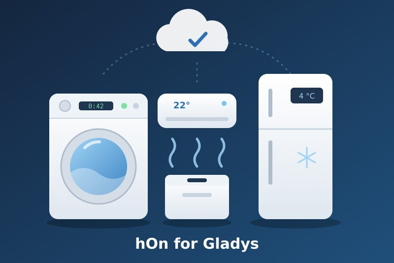
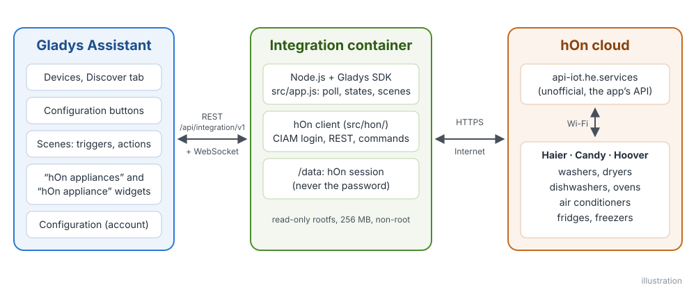
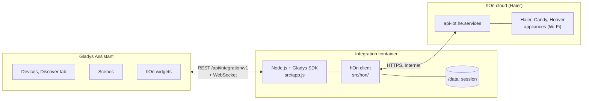
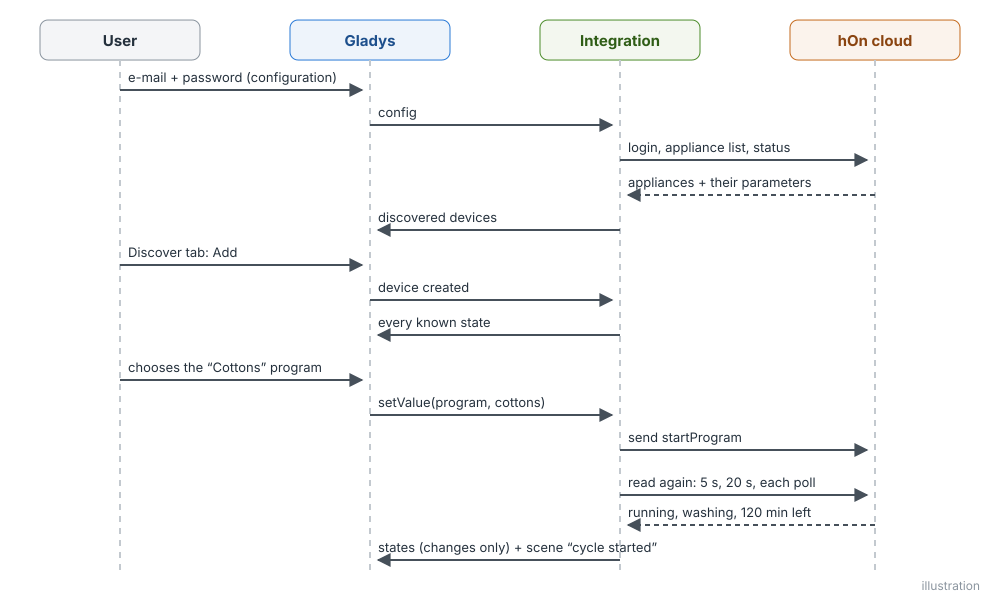
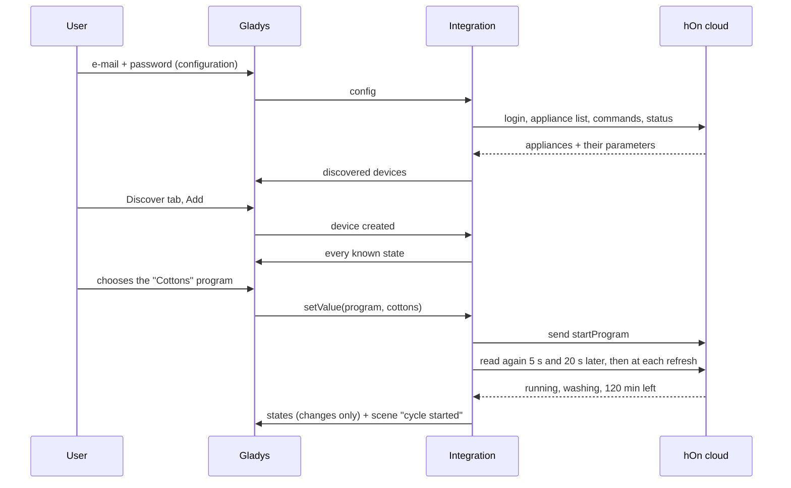
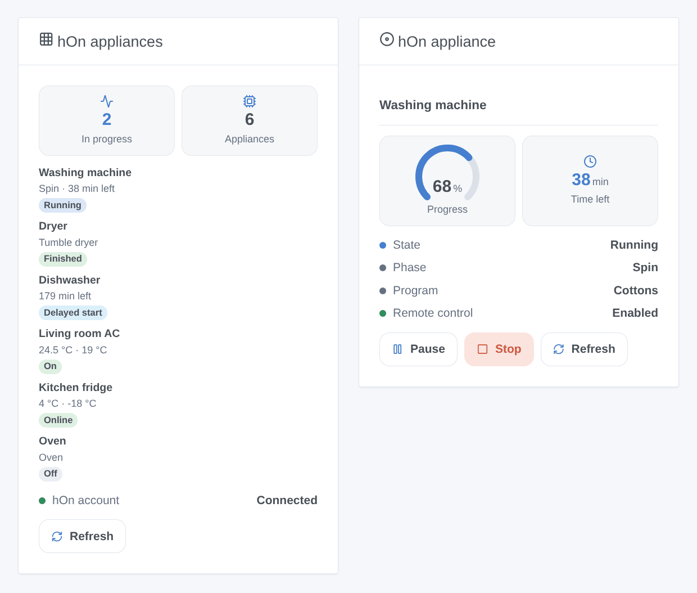
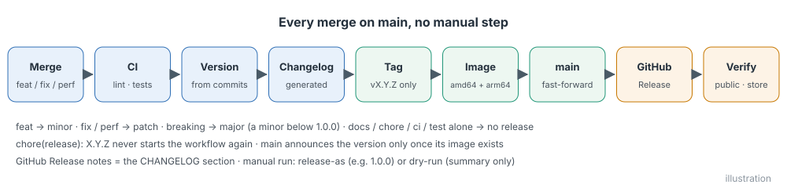

# hOn for Gladys Assistant

**English** | [Français](README.fr.md) | [Deutsch](README.de.md) | [Español](README.es.md)

[](LICENSE)
[](https://github.com/William-De71/gladys-hon/releases)
[](https://github.com/William-De71/gladys-hon/actions/workflows/release.yml)
[](https://gladysassistant.com)



Your Haier, Candy and Hoover appliances of the hOn app in Gladys Assistant: washing machines, dryers, dishwashers, air conditioners, fridges and ovens on the dashboard and in the scenes. Follow a cycle to its end, start a program, get told when the salt runs out.

## Features

- **Account**: the e-mail address and password of the hOn app, through its CIAM login (June 2026). The session is kept in `/data` and reused after a restart; a refused login pauses the next attempts instead of locking the account.
- **Devices**, found in the Discover tab with the features each model reports: washing machines, washer dryers, tumble dryers, dishwashers, air conditioners, fridges, freezers, wine cellars, ovens and the other hOn types.
- **Commands**: start a program (program selection), pause and resume a cycle, air conditioner on/off, mode, setpoint, fan speed and swing, fridge setpoints and modes, when remote control is enabled on the appliance.
- **States** read every 30 s to 5 min, published within the Gladys rate limit, with a cloud / unreachable badge per appliance.
- **Two dashboard widgets**: "hOn appliances" (every appliance) and "hOn appliance" (one appliance, its progress and its buttons).
- **Seven scene triggers** (cycle started, cycle finished, error, refill needed, offline, online, account refused) and **three scene actions** (start a program, pause / resume / stop, read the state).
- English, French, German and Spanish.

## How it works





The integration lists the appliances of the account every 30 minutes, reads their commands (programs, settings) once a day and their status at each refresh. A feature exists when the appliance reports its parameter, so two models of the same type may differ.





### Devices and features

| Appliance                                        | Features (category / type)                                                                                                                                                                                                                                                                           |
| ------------------------------------------------ | ---------------------------------------------------------------------------------------------------------------------------------------------------------------------------------------------------------------------------------------------------------------------------------------------------- |
| Washing machine, washer dryer, dryer, dishwasher | State, Phase (`text`), Program (`text` / `select`, starts it), Remaining time (`duration`, min), Pause (`switch`), Door (`opening-sensor`), Remote control, Salt and rinse aid to refill (`unknown` / `binary`), Energy (`energy-sensor` / `index`, kWh), Water (`volume-sensor`, L), Error (`text`) |
| Air conditioner                                  | On/Off, Mode, Setpoint, Fan speed, Vertical and horizontal swing (`air-conditioning`), indoor and outdoor temperatures (`temperature-sensor`), Energy, Error                                                                                                                                         |
| Fridge, freezer, wine cellar                     | Zone temperatures (`temperature-sensor`), zone setpoints (`thermostat` / `target-temperature`), doors (`opening-sensor`), super cool, super freeze, holiday and auto modes (`switch`), Mode list (`text` / `select`), room temperature and humidity, Error                                           |
| Oven                                             | State, Remaining time, Remote control, temperature and selected temperature, Error (read only)                                                                                                                                                                                                       |
| Other types (hood, hob, water heater, purifier…) | State, temperature, remaining time, Error, when reported                                                                                                                                                                                                                                             |

Device external id: `ext:<selector>:appliance:<MAC address without dashes>`; features: `…:<feature key>`.

## Transport

`transports: ["cloud"]`: everything goes through the hOn cloud, over the Internet — your appliances, their states and your commands pass through Haier's servers. Each appliance shows a **cloud** badge, or **unreachable** when it is not connected to the hOn cloud (power cut, Wi-Fi) or when the account is refused. There is no local channel, so no "Prefer the local connection" button.

## Widgets



- **hOn appliances**: running count, number of appliances, every appliance with its state badge and its phase and time left (or temperatures), the hOn account status, a Refresh button. Setting: all appliances or only those running.
- **hOn appliance**: one appliance chosen in the settings: state, phase, program, remote control, error, a progress gauge and the time left during a cycle, temperatures (the setpoints of a fridge that reports none), and Pause, Resume, Stop (with confirmation) or Turn on / Turn off buttons.

The images are generated by `docs/illustrations/render.sh` from the real widget code: they are illustrations, not screenshots.

## Scene triggers and actions

| Trigger             | Filters         | Variables                                                       |
| ------------------- | --------------- | --------------------------------------------------------------- |
| `cycle_started`     | appliance, type | `device_name`, `appliance_type`, `program`, `remaining_minutes` |
| `cycle_finished`    | appliance, type | `device_name`, `appliance_type`, `program`, `duration_minutes`  |
| `appliance_error`   | appliance       | `device_name`, `appliance_type`, `error_code`                   |
| `refill_needed`     | appliance, item | `device_name`, `appliance_type`, `item`                         |
| `appliance_offline` | appliance       | `device_name`, `appliance_type`                                 |
| `appliance_online`  | appliance       | `device_name`, `appliance_type`                                 |
| `account_error`     |                 | `reason`                                                        |

| Action           | Fields                                  | Outputs                                                                                     |
| ---------------- | --------------------------------------- | ------------------------------------------------------------------------------------------- |
| `start_program`  | appliance, program, delayed start (min) | `program`, `estimated_minutes`                                                              |
| `control_cycle`  | appliance, `pause` / `resume` / `stop`  |                                                                                             |
| `refresh_status` | appliance                               | `machine_state`, `program_phase`, `program`, `remaining_minutes`, `connected`, `error_code` |

A command sent by a scene action never fires a trigger (the transition it causes is muted for that appliance). Examples:

- **The washing machine's cycle is finished** → send "The laundry is ready ({{triggerEvent.data.duration_minutes}} min)".
- **The dishwasher needs salt** → notify the family.
- Every weekday at 1 pm, off-peak → **Start an hOn program** `eco_40_60` on the washing machine loaded in the morning.

## Requirements

- Gladys Assistant **5.1.1 or later** (dashboard widgets and scene triggers and actions of integrations; older instances cannot install the integration).
- An hOn account where the appliances are added and connected. Log in to the hOn app once after creating the account or changing the password. Accounts with two-step verification by e-mail are not supported.
- Internet access for Gladys.

## Installation

- **From the store**: Integrations → search "hOn" → Install.
- **From the repository URL**: Integrations → Install an integration → paste `https://github.com/William-De71/gladys-hon`.
- **Developer mode**: Integrations → Install an integration → Developer mode, with the manifest of a build (the summary of the "Build and publish image" workflow prints it).

## Configuration

| Field           | Type   | Default | Meaning                                               |
| --------------- | ------ | ------- | ----------------------------------------------------- |
| `email`         | string |         | e-mail address of the hOn account                     |
| `password`      | secret |         | password of the hOn account                           |
| `poll_interval` | select | `60`    | refresh interval in seconds: `30`, `60`, `120`, `300` |
| `language`      | select | `en`    | language of the feature names and of the text states  |

Buttons of the configuration page: **Test the connection** (logs in and lists the appliances with their state), **List the programs** (the program names of the `start_program` scene action), **Diagnostic** (writes what each appliance reports to the Logs tab, for a report).

## Usage

1. Enter the e-mail address and the password of the hOn account, save, press **Test the connection**.
2. Add the appliances from the **Discover** tab.
3. To start a program from Gladys, enable remote control on the appliance first.
4. Add the widgets to a dashboard, create your scenes.

The user documentation is in [docs/en.md](docs/en.md) ([fr](docs/fr.md), [de](docs/de.md), [es](docs/es.md)).

## Limits

- The hOn API is not public: this integration uses the interface of the hOn app, as ported from [pyhOn](https://github.com/Andre0512/pyhOn) / [pyhon-revived](https://github.com/mmalolepszy/pyhon-revived). Haier may change it at any time (it did in June 2026).
- Statuses are polled (30 s minimum); the push channel of the app (MQTT) is not used yet.
- Program names are those of the hOn cloud, in English. Guided recipes and oven programs cannot be started.
- One device per appliance: multi-zone appliances that hOn lists per zone show the first one only.
- Fridge modes are started with the programs of the appliance, like the hOn app does; a freezer whose modes depend on its setpoint keeps them read only. A fridge added with an earlier version gets the **Mode** list and its controllable modes with the **Update** button of the Discover tab.
- Tested with the anonymized appliance data of [hon-test-data](https://github.com/Andre0512/hon-test-data), not yet with a real account: feedback welcome.

## Local development

```bash
npm install
GLADYS_HOST_API_URL=http://localhost:1443 \
  GLADYS_INTEGRATION_TOKEN=… GLADYS_INTEGRATION_SELECTOR=… \
  HON_DATA_DIR=./data DEBUG=gladys-integration-sdk node index.js
```

| Variable                                                                         | Default       | Use                                        |
| -------------------------------------------------------------------------------- | ------------- | ------------------------------------------ |
| `GLADYS_HOST_API_URL`, `GLADYS_INTEGRATION_TOKEN`, `GLADYS_INTEGRATION_SELECTOR` | set by Gladys | connection to the Gladys host API          |
| `HON_DATA_DIR`                                                                   | `/data`       | folder of `session.json` and `device.json` |
| `DEBUG`                                                                          | unset         | `gladys-integration-sdk` for the SDK logs  |

| Script                            | What it does                            |
| --------------------------------- | --------------------------------------- |
| `npm test`                        | the tests (`node --test`), no network   |
| `npm run lint`                    | ESLint                                  |
| `npm run format` / `format:check` | Prettier                                |
| `docs/illustrations/render.sh`    | regenerate the widget illustrations     |
| `scripts/build-cover.sh`          | regenerate `cover.jpg` from `cover.svg` |

## Tests

`npm test` runs the whole integration against the fake Gladys of the SDK and a fake hOn cloud serving the anonymized data of six real appliances (washer, dryer, dishwasher, air conditioner, fridge, oven): login, session renewal and refusal pause, discovery, states, commands and their exact payloads, scene triggers and actions, widgets validated by `validateWidgetContent`. Every feature is checked against the rules of the Gladys core and a discovery baseline (external ids are forever), the manifest against the code, the translations and the release script. The CI also builds the image and starts it like Gladys does (read-only, 256 MB, no network).

## Release process

Every merge on `main` publishes a release when its commits deserve one, with no manual step:

```mermaid
flowchart LR
  A[merge on main] --> B[CI: Prettier, ESLint,<br/>tests, Docker build]
  B --> C[next version from<br/>Conventional Commits]
  C --> D[CHANGELOG.md section]
  D --> E[commit chore release<br/>+ tag vX.Y.Z]
  E --> F[image :X.Y.Z + :latest<br/>amd64 + arm64]
  F --> G[main moves to<br/>the release commit]
  G --> H[GitHub Release]
  H --> I[verify: anonymous pull,<br/>store validator, topic]
```





- `feat` → minor, `fix` / `perf` → patch, `!` or `BREAKING CHANGE:` → major (a minor below 1.0.0). `docs`, `chore`, `ci`, `test`, `style`, `refactor`, `build` alone publish nothing.
- The pull request title becomes the squash commit, hence the changelog line: write it in English, for the user (`feat(devices): …`). `pr-title.yml` checks it. Never edit `CHANGELOG.md` by hand.
- The image exists before `main` announces its version (the store indexes `main`).
- 1.0.0 is a manual decision: Actions → Release → Run workflow, `release-as: 1.0.0`. `dry-run` shows the version and the changelog without publishing.
- **Protected `main`**: the release pushes a commit to `main`. With a branch protection or a ruleset, allow GitHub Actions to bypass it (or use a GitHub App), otherwise the release stops after the image.
- After the first release, make the package public: Package settings → Change visibility → Public.

## Troubleshooting

- **"hOn refused the e-mail address or the password"**: check them in the hOn app. The same answer comes when the account logged in too often: the integration waits (15 min, then longer) and retries by itself.
- **"Remote control is off"**: enable it on the appliance panel; most models switch it off at the end of a cycle.
- **No appliance**: add them in the hOn app, then **Test the connection**.
- **A feature is missing**: features follow what the model reports; open an issue with the type and the model (`HON_TYPE` and `HON_MODEL` device parameters).
- Logs: the Logs tab of the integration. For a report, click **Diagnostic** in the configuration and copy the lines starting with `hOn diagnostic` (Gladys cannot set `DEBUG` on the container: that variable only serves a local run).

## Contributing

Issues and pull requests are welcome. Run `npm run format:check`, `npm run lint` and `npm test`, write the pull request title as a Conventional Commit, and run `docs/illustrations/render.sh` after any change to a widget content. A new feature needs a labeled Gladys category/type pair (`test/devices.test.js`) and must not change an existing one (`test/fixtures/discovery.baseline.json`).

## Security

See [SECURITY.md](SECURITY.md). The password is a `secret` field: never logged, never sent back to the browser, only sent to the hOn cloud. The session in `/data` is readable by the container user only.

## License

[Apache License 2.0](LICENSE), see also [NOTICE](NOTICE). The hOn client is a port of [pyhOn](https://github.com/Andre0512/pyhOn) and [pyhon-revived](https://github.com/mmalolepszy/pyhon-revived) (MIT, [licenses/pyhOn-MIT.txt](licenses/pyhOn-MIT.txt)); the test fixtures come from [hon-test-data](https://github.com/Andre0512/hon-test-data) (MIT). hOn, Haier, Candy and Hoover are trademarks of their owners; this project is not affiliated with, endorsed or supported by Haier Europe.
